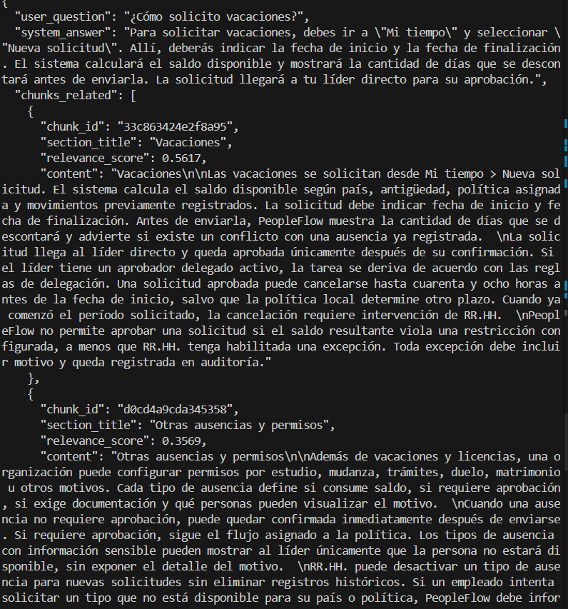
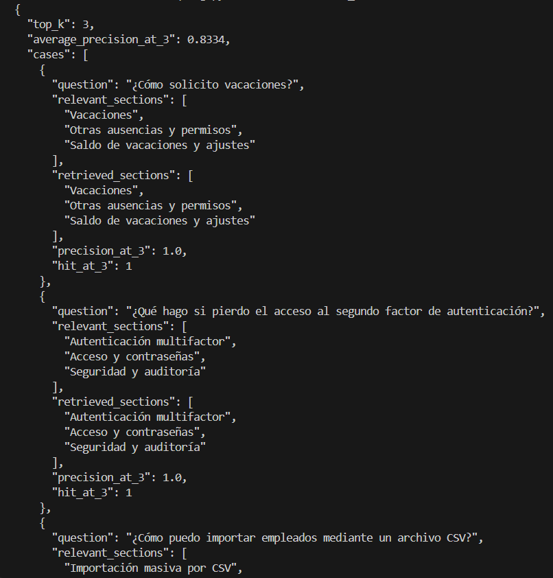

# PeopleFlow FAQ RAG

An HR FAQ application that uses Retrieval-Augmented Generation (RAG) to answer questions about PeopleFlow, a fictional HR platform. It combines semantic-first, token-aware chunking, OpenAI embeddings, a persistent Chroma vector store, and Top-K retrieval to supply context for answer generation.

The public JSON response keeps the question, generated answer, and supporting chunks together, including chunk IDs, section titles, and relevance scores. A separate retrieval evaluation compares the retrieved sections with predefined labels, independently of answer generation.

[Demo](#demo) · [Architecture](#architecture) · [Output Contract](#output-contract) · [Installation](#installation) · [Usage](#usage)

## What it does

1. Loads the complete PeopleFlow knowledge base from a UTF-8 text file.
2. Splits it by document and section headings, subdividing oversized sections using token counts.
3. Generates one OpenAI embedding per chunk and stores the chunks, metadata, and vectors in Chroma.
4. Embeds a user question using the same configured embedding model.
5. Retrieves the Top-K most relevant chunks, with `TOP_K=3` by default.
6. Passes the question and labeled chunk context to the chat model, which is instructed to answer only from that evidence.
7. Returns a Pydantic-validated JSON object containing the answer and retrieved evidence.

## Demo

### RAG query

A real vacation query showing the generated answer, chunk IDs, section titles, relevance scores, and retrieved content.



### Retrieval evaluation

A recorded evaluation showing Top-K, mean Precision@3, and per-case relevant sections, retrieved sections, Precision@3, and Hit@3.



## Key Facts

- **Complete source loading:** one UTF-8 document with **3,647 whitespace-separated words**; section splitting retains all source body text.
- **26 valid chunks**, each **127–259 tokens** with the configured `text-embedding-3-small` tokenizer.
- **Persistent index:** the local `peopleflow_faq` collection contains **26 documents** and uses **`l2`** distance.
- **Default Top-K: 3**, used by the query pipeline, saved examples, and retrieval evaluation.
- **Mean Precision@3 on four saved queries: 0.8334**, recomputed from the retrieved section titles in [`outputs/sample_queries.json`](outputs/sample_queries.json) using the current evaluation labels and scoring functions.

The retrieval score summarizes the saved query evidence, rather than a new live retrieval run. Corpus counts, token ranges, stored index configuration, and the saved-result calculation can be checked without paid OpenAI calls.

## Tech Stack

| Technology | Role |
| --- | --- |
| Python 3.10+ | Indexing, query CLI, validation, and evaluation. |
| OpenAI `text-embedding-3-small` | Chunk and query embeddings. |
| OpenAI `gpt-4o-mini` | Context-based answer generation and optional response evaluation. |
| LangChain | Text loading, heading-aware and recursive splitting, prompts, models, and output parsing. |
| Chroma via `langchain-chroma` | Persistent local vector storage and similarity retrieval. |
| tiktoken | Token counting with the configured embedding model's encoding. |
| Pydantic 2.x | Public response schemas and structured evaluator validation. |
| python-dotenv | Local environment configuration. |
| pytest | Offline tests, including mocked retrieval and model calls. |

The model names above are configured in [`.env.example`](.env.example). Direct dependency versions are pinned in [`requirements.txt`](requirements.txt).

## Architecture

### Indexing pipeline

```text
Knowledge base: data/faq_document.txt
  -> TextLoader
  -> Heading-based semantic sections
  -> Token-aware chunks + token-range validation
  -> OpenAI chunk embeddings
  -> Persistent Chroma collection (l2)
```

### Query pipeline

```text
User question
  -> OpenAI query embedding
  -> Top-K Chroma retrieval
  -> Labeled chunk context
  -> GPT-4o-mini answer text
  -> Pydantic RAGResponse
  -> JSON with answer and supporting chunks
```

[`src/index.py`](src/index.py) coordinates indexing; [`src/query.py`](src/query.py) coordinates retrieval, context construction, generation, and public response assembly. The question embedding is generated internally by Chroma's LangChain wrapper using its configured embedding function.

## Key Engineering Decisions

### Semantic-first chunking

Headings establish section boundaries before size-based splitting. Sections that fit the token budget stay intact, keeping related policy details together instead of fragmenting every section into fixed-size windows.

### Token-aware splitting

`tiktoken` measures the actual encoding used for the embedding model. Oversized sections are split with `RecursiveCharacterTextSplitter.from_tiktoken_encoder()`, reserving space for the section title in each resulting chunk.

### Controlled overlap

Overlap is applied only when a section needs subdivision. It stays inside that section and does not mix content across different section headings.

### Persistent vector store and stable IDs

Chroma persists the index locally, so queries reuse existing chunk embeddings. Chunk IDs are the first 16 hexadecimal characters of a SHA-256 hash of the chunk content, providing stable identifiers for unchanged chunks and their saved evidence.

### Grounded generation

The generation prompt limits answers to retrieved documentation and specifies an insufficient-information response. This makes evidence use explicit, while leaving factual correctness and evidence sufficiency subject to review.

### Structured public output

The model generates answer text through `StrOutputParser`; Python assembles that text and retrieval evidence into a Pydantic `RAGResponse`. This validates the public contract without asking the answer-generation model to produce the entire JSON payload.

### Retrieval evaluation separated from generation

Precision@3 and Hit@3 measure which sections retrieval returns against predefined relevant sections. This tests the retrieval component directly, separately from the optional model-based assessment of a completed answer.

## Chunking Strategy

[`src/document_loader.py`](src/document_loader.py) reads the full knowledge base without an additional cleaning stage. [`src/chunking.py`](src/chunking.py) recognizes `#` document headings and `##` section headings, then counts tokens after including each section's title.

| Parameter | Value | Purpose |
| --- | --- | --- |
| `MAX_SECTION_TOKENS` | 300 | Keep a titled section intact when it fits this budget. |
| `SPLIT_CHUNK_SIZE` | 200 | Target size when subdividing larger sections, with title tokens reserved. |
| `CHUNK_OVERLAP` | 30 | Preserve local continuity between parts of the same oversized section. |

The current corpus yields 26 sections and 26 chunks. Titled sections measure 127–259 tokens, so all fit the 300-token threshold and require no subdivision or overlap. The validation step accepts chunks between 50 and 500 tokens.

Chunks retain source and heading metadata, part number, total parts, and token count. Keeping whole sections for this corpus avoids unnecessary duplication; the subdivision path handles longer sections when needed.

## Embeddings and Vector Store

[`src/embeddings.py`](src/embeddings.py) creates `OpenAIEmbeddings` using `EMBEDDING_MODEL`. Indexing embeds every chunk once; queries embed the question using the model configured when opening the store.

| Setting | Implementation |
| --- | --- |
| Collection | `peopleflow_faq` |
| Persistence | `storage/chroma/`, excluded from Git |
| Distance space | `COLLECTION_CONFIGURATION = {"hnsw": {"space": "l2"}}` |
| Search method | `similarity_search_with_relevance_scores()` |
| Default retrieval size | `TOP_K=3`; the Python retrieval helper accepts values from 2 to 5 |

The `l2` configuration is explicit in [`src/vector_store.py`](src/vector_store.py) and matches the local persisted collection. LangChain converts distances to relevance scores; [`src/retrieval.py`](src/retrieval.py) rounds them to four decimal places. These are retrieval scores, not calibrated probabilities, and the application does not clamp or validate them to `[0, 1]`.

Top-K=3 keeps a small context set and aligns the query pipeline, saved responses, and evaluation. Retrieval currently applies no relevance threshold or reranking. Rebuild the index after changing the corpus or embedding model, and use the same embedding model for indexing and querying.

## Output Contract

The public response has exactly three root keys:

| Field | Type | Content |
| --- | --- | --- |
| `user_question` | `str` | Question after trimming surrounding whitespace. |
| `system_answer` | `str` | Generated answer text. |
| `chunks_related` | `list[ChunkRelated]` | Retrieved evidence with ID, title, score, and content. |

Both schemas in [`src/schemas.py`](src/schemas.py) reject extra fields. The following excerpt comes from the first saved response in [`outputs/sample_queries.json`](outputs/sample_queries.json). Only the first of three chunks and the opening sentences of the answer and content are shown; the original Spanish is preserved.

```json
{
  "user_question": "¿Cómo solicito vacaciones?",
  "system_answer": "Para solicitar vacaciones, debes ir a Mi tiempo > Nueva solicitud.",
  "chunks_related": [
    {
      "chunk_id": "33c863424e2f8a95",
      "section_title": "Vacaciones",
      "relevance_score": 0.5617,
      "content": "Vacaciones\n\nLas vacaciones se solicitan desde Mi tiempo > Nueva solicitud."
    }
  ]
}
```

The saved file contains four query responses, each with three supporting chunks. Evaluator results remain separate from this public JSON. Pydantic validates fields and types, not whether an answer is factually supported.

## Handling Insufficient Evidence

The RAG prompt instructs the model to return this text when the retrieved context cannot support an answer:

```text
No tengo información suficiente en la documentación disponible.
```

This is prompt-directed behavior, not a guarantee against unsupported answers. There is no separate programmatic sufficiency check or relevance threshold that forces the fallback.

The implementation also rejects empty questions, out-of-range Top-K values, missing or empty indexes, chunks outside the 50–500 token validation range, and invalid public or evaluator payloads. These errors propagate to the caller.

## Retrieval Evaluation

Run the retrieval-only evaluation with:

```bash
python -m src.evaluate_retrieval
```

[`src/evaluate_retrieval.py`](src/evaluate_retrieval.py) defines four questions with manually selected relevant section titles:

| Question | Relevant sections |
| --- | --- |
| Vacation request | `Vacaciones`; `Otras ausencias y permisos`; `Saldo de vacaciones y ajustes` |
| Lost MFA device | `Autenticación multifactor`; `Acceso y contraseñas`; `Seguridad y auditoría` |
| Employee CSV import | `Importación masiva por CSV`; `Exportaciones` |
| A leader changing a team's vacation balance | `Saldo de vacaciones y ajustes`; `Vacaciones` |

- **Precision@3:** the number of retrieved chunks whose section title matches a relevant section, divided by 3.
- **Hit@3:** `1` if at least one of the top three chunks matches a relevant section, otherwise `0`.
- **`average_precision_at_3`:** the mean of the four per-question Precision@3 values, rounded as implemented by the script.

The CSV import and leader-balance cases label only two relevant sections; Precision@3 still divides by three.

Recomputing these functions over the recorded retrieval outputs in `outputs/sample_queries.json` gives Precision@3 values of `1.0`, `1.0`, `0.6667`, and `0.6667`, with Hit@3 equal to `1` for each case and a mean Precision@3 of **0.8334**. This calculation uses saved evidence and does not rerun the retriever.

The live command prints `top_k`, the mean score, and per-case questions, labels, retrieved sections, and scores. It makes query-embedding calls to OpenAI but does not call the generative model. These metrics evaluate retrieval against the chosen labels; they do not measure factual answer accuracy.

## Optional Evaluator

[`src/evaluator.py`](src/evaluator.py) provides a separate model-based assessment of chunk relevance, answer grounding, and completeness. It uses `ChatPromptTemplate`, the configured chat model with `temperature=0`, and `with_structured_output(EvaluationResult)`.

The validated result contains `score`, an integer from **0 to 10**, and `reason`, a justification of at least **50 characters** after trimming whitespace. The prompt requests the explanation in Spanish. `validate_evaluation()` validates the returned payload again.

This evaluator requires an additional model call when invoked. It is not called by the normal query CLI and does not change the public RAG output contract.

## Installation

Use **Python 3.10 or newer within the Python 3 series**, `pip`, and an OpenAI API key. Run commands from the repository root (`m2/m2-faq-rag` in this workspace).

### 1. Create and activate a virtual environment

Windows PowerShell:

```powershell
python -m venv .venv
.\.venv\Scripts\Activate.ps1
```

macOS / Linux:

```bash
python3 -m venv .venv
source .venv/bin/activate
```

### 2. Configure environment variables

Copy [`.env.example`](.env.example) to `.env` and set a real API key. Keep any existing configured `.env`.

Windows PowerShell:

```powershell
Copy-Item .env.example .env
```

macOS / Linux:

```bash
cp .env.example .env
```

```dotenv
OPENAI_API_KEY=your-key-here
EMBEDDING_MODEL=text-embedding-3-small
LLM_MODEL=gpt-4o-mini
```

`OPENAI_API_KEY` is used for embeddings, answer generation, and optional evaluation. `EMBEDDING_MODEL` also selects the tokenizer used for chunking; `LLM_MODEL` selects the chat model. The `.env` file is excluded from Git.

### 3. Install dependencies

```bash
python -m pip install -r requirements.txt
```

## Usage

### Build or rebuild the index

```bash
python -m src.build_index
```

This entry point delegates to the existing indexing implementation. It replaces `storage/chroma/` and embeds all source chunks, so it can rebuild the index from a clean clone or refresh it after source changes.

### Query the knowledge base

```bash
python -m src.query --question "¿Cómo solicito vacaciones?"
```

The CLI prints the public response as indented JSON. A persisted index is required; querying makes an embedding call and a chat-model call. Recorded responses are available in `outputs/sample_queries.json` without rerunning generation.

### Evaluate retrieval

```bash
python -m src.evaluate_retrieval
```

### Run tests

```bash
python -m pytest
```

## Tests

The suite in [`tests/`](tests) covers source loading, chunk generation and token bounds, metadata retention, deterministic content IDs, empty questions, Top-K limits, empty indexes, the public output contract, evaluator validation, query logic with mocks, and saved-sample consistency.

The tests use mocked retrieval and generation where needed and do not call OpenAI. They verify implementation behavior and stored artifact consistency; they do not establish live retrieval quality or factual answer accuracy.

## Current Limitations

- **One local knowledge base.** The loader targets `data/faq_document.txt`; sources describe a fictional HR platform.
- **Vector retrieval only.** No hybrid search, reranking, or minimum relevance threshold.
- **Fixed default context size.** Queries use Top-K=3, and the evaluation explicitly requires that value.
- **Manual index refresh.** The local Chroma index is rebuilt explicitly; source edits are not synchronized automatically.
- **OpenAI dependency.** Indexing and retrieval use OpenAI embeddings; generation and optional evaluation use OpenAI chat models.
- **Prompt-based grounding.** Neither the fallback instruction nor schema validation independently verifies factual correctness.
- **Small evaluation set.** Four manually labeled questions cover a narrow set of retrieval cases; the reported score applies to the recorded examples.

## Project Structure

```text
.
├── README.md
├── requirements.txt
├── .env.example
├── data/faq_document.txt
├── docs/images/                     # Public README screenshots
├── outputs/sample_queries.json     # Recorded responses and retrieved evidence
├── src/
│   ├── build_index.py               # Public indexing entry point
│   ├── index.py                     # Indexing pipeline
│   ├── document_loader.py
│   ├── chunking.py
│   ├── embeddings.py
│   ├── vector_store.py
│   ├── retrieval.py
│   ├── query.py
│   ├── schemas.py
│   ├── evaluate_retrieval.py
│   └── evaluator.py
└── tests/
```

`storage/chroma/` is generated locally and excluded from Git. Original screenshots remain in the ignored `references/` directory; only the public copies under `docs/images/` are intended for version control.

Developed as the Module 2 final project for an AI Engineering program.
